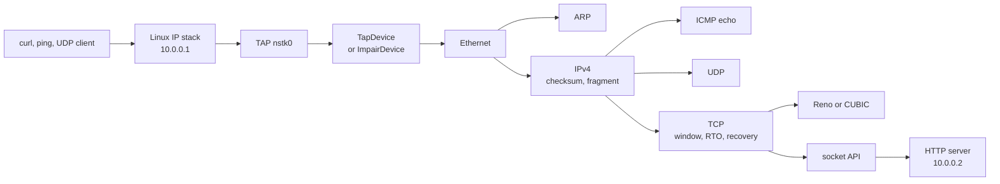

# netstack

A userspace TCP/IP stack for Linux. It speaks Ethernet on a TAP device, answers ARP, and runs IPv4, ICMP echo, UDP, and TCP. TCP has the connection state machine, a sliding window, Jacobson/Karels retransmission timing, fast retransmit, and congestion control (NewReno recovery with either Reno or CUBIC growth). An HTTP server on top of that API is what `curl` and `ping` talk to. Nothing here is a wrapper around the kernel's TCP.



The kernel owns `10.0.0.1/24` on the TAP. The stack owns `10.0.0.2` and must not have that address assigned in the kernel, or the kernel answers ARP for it. Design notes, including what was left out on purpose, are in [docs/WALKTHROUGH.md](docs/WALKTHROUGH.md).

## Build

Requires CMake 3.16+, a C++20 compiler, and Linux headers. This tree is built with g++ 13. Point CMake at `g++` if `c++` on the machine is a clang that cannot find `libstdc++`.

```bash
cmake -S . -B build -DCMAKE_BUILD_TYPE=Release -DCMAKE_CXX_COMPILER=g++
cmake --build build -j
ctest --test-dir build --output-on-failure
```

The unit tests do not need root or a TUN device. They run two stacks over an in-process link with a manual clock. Address and undefined-behavior sanitizers:

```bash
cmake -S . -B build-asan -DCMAKE_BUILD_TYPE=Debug -DCMAKE_CXX_COMPILER=g++ -DNETSTACK_SANITIZE=ON
cmake --build build-asan -j
ctest --test-dir build-asan --output-on-failure
```

## Talk to it

`/dev/net/tun` and `CAP_NET_ADMIN` (or root) are required. `--setup` assigns the host address, brings the link up, and sets `rp_filter=0` on both the interface and `conf/all` so replies from `10.0.0.2` are not dropped.

```bash
sudo ./build/http_server --setup --tap nstk0 --host-ip 10.0.0.1 --stack-ip 10.0.0.2 \
  --port 80 --cc reno --udp-echo 9999
```

In another shell:

```bash
ping -c 3 10.0.0.2
ping -M dont -c 1 -s 2000 10.0.0.2
curl -sS http://10.0.0.2/health
curl -o /dev/null http://10.0.0.2/download?n=1048576
echo -n netstack-udp | nc -u -w1 10.0.0.2 9999
```

`--cc cubic` selects CUBIC. `--pcap out.pcap` writes a classic pcap (Ethernet, link type 1). `--trace out.json` writes the event log the viewer reads. `--drop-seg N` drops the Nth data segment of each connection once, so a fast retransmit can be forced without a lossy link. `--delay-ms` and `--loss` (a probability from 0 to 1) delay and drop non-ARP frames inside the process. ARP is left alone so neighbor discovery is not the thing under test.

## Measurements

`scripts/measure.py` is the only source of the numbers below. It starts the server, runs ping, curl, a fragmented ping, and a UDP echo, and writes `results/measurements.json` plus pcaps and JSON traces under `results/traces/`. Every figure in the table is copied from that file.

The script tries `tc qdisc replace dev lo root netem`. On this kernel that probe fails (`CONFIG_NET_SCH_NETEM` is not set; `tc` reports `Specified qdisc kind is unknown`). The runs therefore use the in-process delay and loss on the TAP device, in both directions, and the JSON records `shaping.mode = "device"` together with the `tc` error. A machine whose kernel has `sch_netem` takes the `tc` path instead and does not also delay inside the process. ARP frames are not delayed or dropped on the device path. The ping RTT under a 20 ms setting is still about 40 ms, which is the two IP directions.

Idle TAP, Reno, `curl` of `GET /download?n=1048576` (1,048,576 bytes). Five separate server runs. `curl` Mbit/s is `speed_download * 8 / 1e6`. Stack Mbit/s is payload acknowledged on the busiest burst, from the first data segment to the last data ACK, which excludes the handshake.

| run | curl s | curl Mbit/s | stack Mbit/s | retx | fast retx | RTO | checksum drops | frag reassembly |
| --- | ---: | ---: | ---: | ---: | ---: | ---: | ---: | ---: |
| 0 | 0.106051 | 79.099752 | 95.188950 | 0 | 0 | 0 | 0 | 1 |
| 1 | 0.106952 | 78.433384 | 95.495361 | 0 | 0 | 0 | 0 | 1 |
| 2 | 0.105317 | 79.651032 | 97.041045 | 0 | 0 | 0 | 0 | 1 |
| 3 | 0.104796 | 80.047024 | 96.725256 | 0 | 0 | 0 | 0 | 1 |
| 4 | 0.106985 | 78.409192 | 95.186216 | 0 | 0 | 0 | 0 | 1 |

Median curl throughput: **79.099752 Mbit/s**. Each of those runs also answered `GET /health` (HTTP 200, 3 bytes), echoed one UDP datagram of `netstack-udp`, and answered `ping -M dont -c 1 -s 2000`. The first run's fragmented echo was `2008 bytes from 10.0.0.2: icmp_seq=1 ttl=64 time=0.325 ms`. Five-packet ping averages on the idle TAP were 0.234, 0.144, 0.149, 0.233, and 0.147 ms.

512 KiB downloads (`n=524288`) with 20 ms of delay in each direction. Loss runs drop non-ARP frames with probability 0.01. The single-drop runs pass `--drop-seg 4` and do not use random loss. Ping averages are `ping -c 5`.

| cc | loss | drop seg | curl s | curl Mbit/s | stack Mbit/s | retx | fast | RTO | ping avg ms | rexmit ACK | cwnd restored |
| --- | ---: | ---: | ---: | ---: | ---: | ---: | ---: | ---: | ---: | ---: | --- |
| reno | 1% | — | 0.778554 | 5.387296 | 5.814668 | 1 | 1 | 0 | 40.260 | 40.038 ms | no |
| reno | 1% | — | 0.738292 | 5.681088 | 6.156302 | 1 | 1 | 0 | 40.206 | 40.050 ms | no |
| reno | 1% | — | 0.778512 | 5.387584 | 5.819083 | 1 | 1 | 0 | 40.151 | 40.047 ms | no |
| cubic | 1% | — | 0.739107 | 5.674824 | 6.152353 | 1 | 1 | 0 | 40.206 | 40.118 ms | 601 ms |
| cubic | 1% | — | 0.698185 | 6.007432 | 6.543866 | 1 | 1 | 0 | 40.156 | 40.076 ms | no |
| cubic | 1% | — | 0.698382 | 6.005744 | 6.541948 | 3 | 2 | 0 | 40.302 | 40.106 ms, 40.058 ms | no |
| reno | 0 | 4 | 0.979353 | 4.282728 | 4.549510 | 1 | 1 | 0 | 40.248 | 40.047 ms | 321 ms |
| cubic | 0 | 4 | 0.940216 | 4.461000 | 4.753050 | 1 | 1 | 0 | 40.159 | 40.093 ms | 281 ms |

Median curl throughput at 20 ms + 1% loss: **5.387584 Mbit/s** (Reno, 3 runs) and **6.005744 Mbit/s** (CUBIC, 3 runs). "cwnd restored" is the time from loss detection until the connection is out of fast recovery and `cwnd` is at least the pre-loss window. A short transfer often ends before that happens, so the cell says no. On the forced drop, pre-loss `cwnd` was 20,440 bytes in both algorithms.

```bash
python3 scripts/measure.py          # five idle 1 MiB runs, then the impaired runs
python3 scripts/measure.py --quick  # one 256 KiB run, no impairment
```

## Trace viewer

`web/` is a Next.js app that replays `results/traces/*.json` copies shipped in `web/public/traces/`. The sequence diagram draws stack-to-peer segments up to the playhead. The chart is `cwnd` and, once it has left the initial ceiling, `ssthresh`.

```bash
cd web
npm ci
npm run dev
npm run build
```

On Vercel, set the project root directory to `web`. No environment variables are required.

## Layout

| path | what |
| --- | --- |
| `include/netstack/` | public headers: device, checksum, congestion, stack, HTTP |
| `src/` | Ethernet/ARP, IPv4, ICMP, UDP, TCP, Reno, CUBIC |
| `apps/http_server.cpp` | TAP server |
| `tests/` | in-process tests |
| `scripts/measure.py` | live measurements |
| `results/` | recorded numbers, pcap, JSON traces |
| `web/` | trace viewer |
| `docs/WALKTHROUGH.md` | decisions worth defending |
| `docs/RESUME.md` | three resume bullets taken from the table above |
